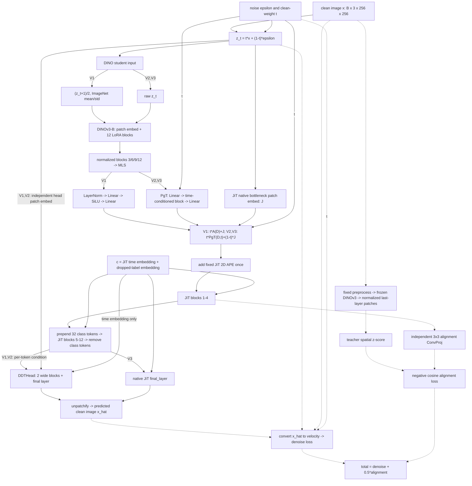

# Residual 三个变体的统一数据流

本文按 2026-10-08 的当前源码和三个实验配置描述实际前向路径。共同模块只介绍一次，在 student 输入处理、DINO 输出投影、两路融合和像素输出头处展开变体差异。下文 block 使用从 1 开始的编号，同时标注必要的代码索引。

## 1. 变体对应关系

| 编号 | 实验简称 | 实际配置 |
| --- | --- | --- |
| V1 | `BaseT-Residual(t,1)-B-80` | [旧 Residual 配置](../configs/Ours-J18-new-drop0.1-l4-BaseT-Residual-B-80.yaml) |
| V2 | `BaseT-Residual(t,1-t)-NoDinoPre-PgT-B-80` | [PgT 配置](<../configs/BaseT-Residual(t,1-t)-NoDinoPre-PgT-B-80.yaml>) |
| V3 | `BaseT-Residual(t,1-t)-NoDinoPre-PgT-NoDDTHead-B-80` | [NoDDTHead 配置](<../configs/BaseT-Residual(t,1-t)-NoDinoPre-PgT-NoDDTHead-B-80.yaml>) |

V1 的实际实验目录仍是 `checkpoints/Ours-J18-new-drop0.1-l4-BaseT-Residual-B-80`；V2/V3 的目录与实验简称一致。名称中的 `(t,1)`、`(t,1-t)` 均按 **DINO 路权重、JiT 原生 patch 路权重** 排列。

| 比较项 | V1 | V2 | V3 |
| --- | --- | --- | --- |
| noisy DINO student 输入 | `(z_t+1)/2` 后 ImageNet 标准化 | 原始 `z_t` | 同 V2 |
| DINO student 主体 | DINOv3-B/16 + LoRA-r64 + MLS | 相同结构 | 相同结构 |
| DINO 到 JiT 的投影 | LayerNorm + 两层 MLP adapter | PixelDiT2 `TimestepProjection`，简称 PgT | 同 V2 |
| 融合前空间 token | `t*A(D) + J` | `t*PgT(D,t) + (1-t)*J` | 同 V2 |
| JiT 主干 | 12 blocks，宽度 768 | 相同结构 | 相同结构 |
| 对齐监督 | JiT block 4 + ConvProj 对齐 clean teacher | 相同 | 相同 |
| 像素输出头 | DDTHead，宽度 2048，2 blocks | 相同结构 | 原生 JiT `final_layer` |
| 可训练参数，训练日志值 | 308.84M | 320.25M | 159.05M |

V1 到 V2 同时改变了 **输入预处理、投影结构、JiT 路融合权重**；V2 到 V3 的结构改动只在输出头。相同结构表示配置与算子一致，不表示三个实验共享训练后的权重。参数量不计冻结 DINO/teacher 和 EMA 副本。

`NoDinoPre` 只关闭 noisy student 图像进入 DINO 前的像素域映射和 ImageNet 标准化。DINO 内部 LayerNorm、提取多层特征时的最终 LayerNorm、PgT 内部 RMSNorm，以及 teacher 的标准预处理都保留。

## 2. 统一框架与张量约定

`B` 是单卡 batch；当前四卡训练为每卡 64、全局 256。输入图像为 `256x256`，patch size 为 16，因此空间 token 数 `N=16x16=256`。DINO 和 JiT 主干宽度均为 `C=768`。

下面的分支是按变体选择执行，三个模型不会同时计算两种 adapter 或两种输出头。虚线表示仅训练时使用的监督支路。



这里有三种用途不同的“投影”：进入 JiT 前的 adapter/PgT、训练监督用的 ConvProj、DDTHead 内的 `z_proj`。它们参数不共享，数据流位置也不同。

## 3. 图像、时间与标签

训练集图像先转 RGB、缩放并中心裁剪到 `256x256`，按概率 0.5 水平翻转。训练循环将像素映射到 `[-1,1]`，得到 `x [B,3,256,256]`。

三个变体使用相同的 rectified-flow 定义：

```text
u       ~ Normal(-0.8, 0.8^2)
t       = sigmoid(u)                         # [B]
epsilon ~ Normal(0, I)                       # [B,3,256,256], noise_scale=1
z_t     = t*x + (1-t)*epsilon                # broadcast t over C/H/W
```

**t 是干净图像的权重**：`t=0` 为纯噪声，`t=1` 为干净图像；采样从 0 积分到 1。加噪后的 `z_t` 不受 `[-1,1]` 限制，不能把其 `(z_t+1)/2` 的结果理解为严格落在 `[0,1]`。

标签 `y [B]` 属于 `0..999`；训练中以 0.1 概率替换为 null label `1000`。三个变体都保留 null-label 样本的 DINO 路径：`dino_residual_drop_on_label_drop=false`，V2/V3 的 `dino_grounding_drop_on_label_drop=false`。

## 4. 共同的两路输入编码

### 4.1 DINO student 输入处分流

V1 在 `_encode_noisy_student` 中调用 `_preprocess_for_dino`：

```text
z01       = (z_t.float() + 1) / 2
dino_in   = (z01 - mean) / std
mean      = [0.485, 0.456, 0.406]
std       = [0.229, 0.224, 0.225]
```

这里不做 clamp，标准化也不显式依赖 t。三个变体都没有开启另一个 DinoTNorm 实验使用的 `t_moment` 解析归一化。

V2/V3 直接设置 `dino_in=z_t`，跳过上面的映射和标准化。后面的 DINO 结构和 MLS 公式不变。干净 teacher 是另一条监督路径，仍然使用标准预处理，见第 8 节。

### 4.2 DINO patch embedding 与一个 LoRA block

student 使用预训练 `DINOv3-B/16`。patch embedding 是独立于 JiT 的 `Conv2d(3,768,kernel=16,stride=16)`：

```text
dino_in [B,3,256,256]
    -> DINO PatchEmbed
    -> patch tokens [B,256,768]
    -> prepend 1 CLS token + 4 storage/register tokens
    -> DINO sequence [B,261,768]
```

下面只展开一个 DINO block，其余 11 个 block 重复同一结构、各自持有参数。当前宽度 768、12 个 attention heads、每头 64 维；FFN 使用 GELU，内部宽度 3072。

```text
s [B,261,768]
    |
    +-> LayerNorm
        -> qkv Linear with LoRA (768 -> 2304)
        -> split Q/K/V; apply DINO 2D RoPE to spatial Q/K
        -> self-attention over CLS/register/patch tokens
        -> proj Linear with LoRA (768 -> 768)
        -> LayerScale
        -> residual add to s                         = s_attn

s_attn
    |
    +-> LayerNorm
        -> fc1 Linear with LoRA (768 -> 3072)
        -> GELU
        -> fc2 Linear with LoRA (3072 -> 768)
        -> LayerScale
        -> residual add to s_attn                    = next s
```

每个被包装的 Linear 计算 `W_frozen*h + bias_frozen + (alpha/r)*B_lora*A_lora*h`。当前 `r=64`、`alpha=64`、LoRA dropout 为 0；`B_lora` 初始化为零。12 个 block 的 `qkv/proj/fc1/fc2` 共 48 个 Linear 被注入 LoRA。

原始 DINO Transformer 权重、LayerNorm、LayerScale、CLS/register token 冻结；LoRA 参数和 DINO patch embedding 可训练。冻结原始权重不会切断 student 的计算图，梯度仍可穿过这些算子回传到 LoRA 和 patch embedding。

DINO 使用自己的二维 RoPE，没有新增 JiT 的类别 token、时间 token，也不直接接收 `y` 或 `t` embedding。V2/V3 中显式 t 条件是在后面的 PgT 才加入；DINO 自身通过 `z_t` 感知噪声水平。

### 4.3 12 层中的取层位置与 MLS

student 的取层索引为 `[2,5,8,11]`，即第 3、6、9、12 个 block。每个选中层的输出经 DINO 最终 LayerNorm 处理，再去掉 CLS/register token，得到四份 `H_i [B,256,768]`。

```text
H3, H6, H9, H12 = selected patch features, each with DINO final LayerNorm
layer_mean      = (H3 + H6 + H9 + H12) / 4        # [B,256,768]
last_mean       = mean(H12, dim=patch, keepdim=True)  # [B,1,768]
D               = layer_mean + last_mean         # broadcast -> [B,256,768]
```

这就是 RAEv2-style MLS：层间平均，再加最后一层的空间均值。不是拼接，不改变宽度，也不在 MLS 输出后额外做 L2 normalization。取层时使用最终 Norm 不会把这份归一化结果重新写回 DINO 主干。

当前本地 DINOv3 构建器使用 `layernormbf16`，对应 `LayerNorm(eps=1e-5, elementwise_affine=True)`，三个训练日志中的模型打印也一致。这个值与旧 residual adapter 的 `eps=1e-6` 不同；预训练 affine 参数被冻结并保留。

### 4.4 JiT 原生 patch 路

三个变体都将未经 DINO 标准化的 `z_t` 同时送入 `net.x_embedder`：

```text
z_t [B,3,256,256]
    -> Conv2d(3,128,kernel=16,stride=16,bias=False)
       [B,128,16,16]
    -> Conv2d(128,768,kernel=1,stride=1,bias=True)
       [B,768,16,16]
    -> flatten spatial grid and transpose
       J [B,256,768]
```

两个卷积之间没有激活或 Norm；128 是每个 patch 的中间 bottleneck 宽度，不是 token 数。这里尚未加入 JiT 的绝对位置编码。该模块可训练，与 DINO PatchEmbed、DDTHead PatchEmbed 均不共享权重。

## 5. DINO 输出投影与融合处分流

### 5.1 V1：MLP adapter 和 `(t,1)`

```text
D [B,256,768]
    -> LayerNorm(768, eps=1e-6)
    -> Linear(768,768)
    -> SiLU
    -> Linear(768,768)
    -> A(D) [B,256,768]

F = t*A(D) + J
```

`DINOResidualAdapter` 逐 token 处理，不含 attention，不读取 t；t 只在投影后作为标量门控。最后一个 Linear 的权重和 bias 零初始化，因此初始 `A(D)=0`，融合输入退化为完整的原生 `J`。

adapter 约 1.18M 参数。入口 LayerNorm 不约束最后一个 Linear 的输出范数。该分支只构建 `dino_residual_adapter`，不会再接 PgT。

### 5.2 V2/V3：PixelDiT2 PgT 和 `(t,1-t)`

`dino_input_projector` 使用 `pixeldit2_projector.py::TimestepProjection`，为 1 个时间条件 Transformer block、宽度 768、12 heads，输入输出均为 `[B,256,768]`。

```text
D
    -> input_proj: Linear(768,768)
    -> one ModulatedDiTBlock conditioned on c_pgt
    -> output_proj: Linear(768,768)
    -> P(D,t)

t [B]
    -> sinusoidal embedding, dim=256, max_period=10
    -> Linear(256,768) -> SiLU -> Linear(768,768)
    -> unsqueeze -> c_pgt [B,1,768]

F = t*P(D,t) + (1-t)*J
```

这里直接传入 clean-weight t，不执行 `1-t` 转换；PgT 的时间 embedding 与 JiT 自身的 embedding 参数独立。PgT 不接收类别标签。

一个 PgT block 的具体运算如下。`mod(u,shift,scale)=u*(1+scale)+shift`；调制参数形状为 `[B,1,768]`，沿空间 token 广播。

```text
shift_a, scale_a, gate_a, shift_m, scale_m, gate_m
    = Linear(768,6*768)(SiLU(c_pgt)).chunk(6)

u = input_proj(D)
a = mod(RMSNorm(u), shift_a, scale_a)
a = QKV Linear without bias
    -> Q/K RMSNorm per head
    -> projector-local 2D RoPE, grid 16x16
    -> PyTorch scaled_dot_product_attention
    -> output Linear
u = u + gate_a*a

m = mod(RMSNorm(u), shift_m, scale_m)
m = SwiGLU: (SiLU(w1(m)) * w3(m)) -> w2
    # 768 -> internal width 2048 -> 768
u = u + gate_m*m

P(D,t) = output_proj(u)
```

PgT 内有两处 block RMSNorm 和 Q/K RMSNorm，但 **input_proj 前、output_proj 后均没有额外 Norm**。它不是将旧 MLP 外面再包一层：V2/V3 不构建旧 adapter。

初始化时只将 block 的 AdaLN modulation 末层置零，使 block 初始为恒等映射；`input_proj/output_proj` 保留默认 Linear 初始化。因此初始 `P(D,t)=output_proj(input_proj(D))`，通常不为零，与 V1 的零残差初始化不同。

### 5.3 融合的共同约束

两路逐空间位置相加，结果 `F [B,256,768]`；不会在 token 维或通道维拼接 DINO 与 JiT。融合后再统一执行 `F + JiT.pos_embed`，位置编码只加一次，不乘 t。

| 时间位置 | V1 的融合输入，尚未加 APE | V2/V3 的融合输入，尚未加 APE |
| --- | --- | --- |
| `t=0` | `J` | `J` |
| `0<t<1` | `J + t*A(D)` | `(1-t)*J + t*P(D,t)` |
| `t=1` | `J + A(D)` | `P(D,1)` |

V2/V3 的系数和为 1，但不会自动让两路范数相等，也不会保证融合结果是固定范数。当前代码即使在 `t=0` 或 null label 下也会执行 DINO 路径，然后再乘权重。

## 6. 共同的 JiT 主干与对齐取点

JiT-B/16 共有 12 个 block、宽度 768、12 heads。所有变体调用 wrapper 的 `_jit_forward_from_tokens`，复用 JiT 内部模块，不直接走原始 `net.forward(image,t,y)`。

全局条件为：

```text
t_emb = JiT TimestepEmbedder(t)           # [B,768], sinusoidal max_period=10000
y_emb = Embedding(y_dropped)             # [B,768], including null class 1000
c     = t_emb + y_emb                    # [B,768]
h0    = F + fixed_2d_sincos_pos_embed     # [B,256,768]
```

一个 JiT block 先以 `SiLU(c) -> Linear(768,6*768)` 生成 attention/FFN 各自的 shift、scale、gate，然后执行：

```text
h1 = h  + gate_a * Attention(mod(RMSNorm(h),  shift_a, scale_a), RoPE)
h2 = h1 + gate_m * SwiGLU(  mod(RMSNorm(h1), shift_m, scale_m))
```

调制在空间维广播。Attention 使用带 bias 的 QKV、Q/K RMSNorm 和 JiT 的二维 RoPE；FFN 内部宽度为 2048。此处的 block gate 是学习到的 AdaLN gate，与融合处显式的 t 权重是两件事。

序列按以下顺序经过主干：

1. block 1-4：`[B,256,768]`，全局 c 从第一个 block 起就已包含类别信息。
2. block 4 后取 `H_align [B,256,768]`，供独立 alignment ConvProj 使用；代码索引为 3。
3. block 5 前插入 32 个类别 token：每个为 `y_emb + learned_position_i`。序列变为 `[B,288,768]`，不是增加 32 个不同类别。
4. block 5-12：使用带 in-context 前缀的 RoPE，类别前缀不旋转，空间 token 正常旋转。
5. 移除前 32 个类别 token，得到 `H_out [B,256,768]`，送入所选像素输出头。

`H_align` 不 detach；alignment 梯度可以回到 JiT 前 4 层、输入融合、两路编码及 adapter/PgT。ConvProj 的输出不会替换主干 token，也不会喂给后续 block。

## 7. 像素输出头处分流

### 7.1 V1/V2：DDTHead 的两条内部路径

DDTHead 接收的是 **原始 noisy image `z_t`、JiT 最终空间输出 `H_out` 和 JiT `t_emb`**。它有自己的图像 patch stream；不能把它理解为只对 `H_out` 再加两层 Transformer。

条件路径按 RAEv2-style 顺序构造：

```text
H_out [B,256,768] + t_emb[:,None,:] [B,1,768]
    -> SiLU
    -> z_proj: Linear(768,2048)
    -> C_head [B,256,2048]
```

当前构造函数固定 `time_reinject=True`。`jit_ddt_head.py` 内有旧 docstring 描述“标准 J18-new 关闭”的历史文字，但当前实际调用会重新注入时间。类别已经包含在 `H_out` 中，这里没有再独立添加 `y_emb`。

图像路径为：

```text
z_t [B,3,256,256]
    -> independent BottleneckPatchEmbed: 3 -> 128 -> 2048
    -> head tokens [B,256,2048]
    -> DDTHeadBlock x 2, each conditioned on C_head
    -> DDTHeadFinalLayer
    -> RGB patch predictions [B,256,768]
```

每个 DDTHeadBlock 复用第 6 节的“两次 Norm/调制/残差”模式，但有三项变化：宽度变为 2048、16 heads；调制条件为逐空间位置的 `[B,256,2048]`；FFN 内部宽度为 5461。它是 head stream 的 self-attention，`H_out` 通过 AdaLN 条件作用于 head，不是 cross-attention，也不与 head token 拼接。

head 使用自己的 2D RoPE，不添加绝对位置编码，不插入类别 token。DDT final layer 用 `SiLU(C_head) -> Linear(2048,4096)` 生成逐 token shift/scale，调制 RMSNorm 后的 head token，再通过 `Linear(2048,768)` 输出每个 patch 的 `16*16*3` 个值。

启用 DDTHead 时，`net.final_layer` 保留为冻结模块用于旧 checkpoint 兼容，不参与预测。DDT 的 AdaLN modulation 和最终像素 Linear 均零初始化。

### 7.2 V3：原生 JiT final_layer

V3 的 `use_ddt_head=false`，完全不构建 DDTHead，恢复训练并调用 `net.final_layer`：

```text
c [B,768] -> SiLU -> Linear(768,1536) -> shift, scale [B,768]

H_out [B,256,768]
    -> RMSNorm
    -> global AdaLN: h*(1+scale[:,None,:]) + shift[:,None,:]
    -> Linear(768,768)
    -> RGB patch predictions [B,256,768]
```

这里没有额外 attention block，也没有独立的 noisy-image head embedding。DINO-LoRA、PgT、融合、JiT 12 层、类别条件及 block-4 alignment 全部保留。因此它是输出头消融，而不是退回原始纯 JiT 模型。原生 final layer 的 AdaLN modulation 和像素 Linear 也零初始化。

### 7.3 共同还原图像

两种输出头都返回 `[B,256,768]`，其中最后一维此时表示 RGB patch 像素，不再表示隐藏特征：

```text
[B,256,16*16*3]
    -> reshape to patch grid [B,16,16,16,16,3]
    -> JiT.unpatchify
    -> x_hat [B,3,256,256]
```

模型预测的是干净图像 `x_hat`。输出头不加 sigmoid/tanh，也不直接预测 noise 或 velocity；velocity 由下节的解析关系得到。

## 8. 训练专用 teacher、对齐与总损失

三个变体使用同一套 teacher 和损失定义。teacher 是独立的冻结 DINOv3-B/16，来自相同预训练权重，不带 LoRA，不做 MLS，不是 student 的 EMA。

```text
clean x
    -> (x+1)/2 and ImageNet mean/std normalization
    -> frozen DINOv3-B/16, 12 blocks
    -> last block + DINO final LayerNorm
    -> remove CLS/register tokens
    -> T [B,256,768], no_grad and detach
```

所谓 teacher “raw last” 是指未做 MLS 的最后一层，不表示跳过最终 LayerNorm。teacher 图像与 noisy student 来自同一份裁剪/翻转后的 x，因此空间 patch 位置一一对应。

学生侧监督来源是 **JiT block 4 输出**，不是直接监督 DINO MLS：

```text
H_align [B,256,768]
    -> reshape [B,768,16,16]
    -> Conv2d(768,768,kernel=3,stride=1,padding=1)
    -> flatten [B,256,768]
    -> U
```

模块字段虽叫 `dino_student_projector`，实际是这条 JiT-to-teacher 对齐支路。它没有额外激活或 Norm，与进入 JiT 前的 adapter/PgT 完全独立。

teacher target 的空间 z-score 与损失为：

```text
mu       = mean(T, dim=patch, keepdim=True)          # [B,1,768]
sigma    = std(T, dim=patch, keepdim=True)           # default correction=1
T_target = (T - 0.8*mu) / (sigma + 1e-6)
L_align  = -mean(cosine_similarity(U, T_target, dim=channel))

denom    = clamp_min(1-t, 0.05)
v_target = (x     - z_t) / denom
v_pred   = (x_hat - z_t) / denom
L_denoise = mean((v_pred - v_target)^2)

L_total  = L_denoise + 0.5*L_align
```

对齐计算先转 FP32；固定系数为 0.5，不根据 t 再加权。日志中的 raw MSE、raw cosine、x MSE 和 token 范数是诊断值，不额外加入总损失。由于 alignment 是负 cosine，总 loss 可以为负，不能当作 denoise loss 解读。

去噪梯度经所选输出头回到整条生成路径；对齐梯度经 ConvProj 回到前半段 JiT 及前端。teacher 无梯度。两种损失在同一次 backward 中共同更新可训练模块。

## 9. 采样时保留哪些路径

采样从 `epsilon` 开始，对每个当前状态 `(z_t,t)` 重复执行 DINO student、native patch、对应融合、JiT 和所选输出头。DINO 特征随图像状态重新计算，不是预先计算一次的固定条件。

采样不调用 clean teacher、alignment ConvProj 和训练损失。CFG 活跃时将同一份 `z_t,t` 复制为条件/无条件两半，标签分别为真实类别与 `1000`，一次 `2B` 前向后得到：

```text
x_cfg = x_uncond + scale * (x_cond - x_uncond)
v_cfg = (x_cfg - z_t) / clamp_min(1-t, 0.05)
z_t   -> sampler update -> next z_t
```

三个变体的 null-label 分支都继续 forward DINO 和相应的 adapter/PgT，融合权重不因标签改变。`No CFG`/`scale=1` 表示只使用给定类别的条件预测，不等于把标签改为 null。

当前 YAML 的 online evaluation 为 EMA1、Heun-50、CFG=1、50K 图片；独立 CFG 实验通过采样参数切换到 FlowDPMSolver-100 和指定 scale/interval，不改变上述网络数据流。

## 10. 范数统计与归一化位置

训练诊断中的 token 范数统一为 `mean_{batch,patch}(L2_norm(token, dim=channel))`，不是把整张图或整个 batch 展平后的范数。下面均指加入 JiT APE 之前的前端位置：

| 数据流位置 | V1 日志字段 | V2/V3 日志字段 |
| --- | --- | --- |
| MLS 输出 D | `dino_student_token_norm` | 同左 |
| 原生 JiT 输出 J | `native_jit_patch_token_norm` | 同左 |
| adapter/PgT 输出，尚未乘 t | `dino_residual_pre_gate_norm` | `dino_projected_token_norm` |
| 乘 t 后的 DINO 路 | `dino_residual_post_gate_norm` | `dino_weighted_token_norm` |
| 加权后的 JiT 路 | 权重为 1，等于 native 字段 | `jit_weighted_token_norm` |
| 融合后 F | `jit_input_token_norm` | `jit_input_token_norm` / `jit_blended_token_norm` |
| 两路加权后范数之比 | `dino_residual_to_native_norm_ratio` | `dino_weighted_to_jit_weighted_norm_ratio` |

`alignment_projector_*` 字段测的是 JiT block 4 及其 ConvProj，不能用于代表输入 PgT。范数之比不等于信息贡献之比；两路方向也会影响相加后的范数。

| 归一化位置 | V1 | V2/V3 |
| --- | --- | --- |
| noisy student 图像 ImageNet 标准化 | 有 | 无 |
| DINO block LayerNorm、取层最终 LayerNorm | 有，预训练 affine 冻结 | 保留 |
| MLS 后的额外 feature L2 normalization | 无 | 无 |
| 输入投影模块内部 | adapter 入口 LayerNorm | PgT block RMSNorm、Q/K RMSNorm |
| 输入投影输出处的最终 Norm | 无 | 无 |
| 两路融合后的额外 Norm | 无；随后进入 JiT block 内部 Norm | 相同 |
| JiT 与所选输出头内部 Norm | 有 | 有 |
| clean teacher 标准预处理、最终 LayerNorm、空间 z-score | 有 | 保留 |

## 11. 代码入口索引

| 实现文件 | 对应步骤 |
| --- | --- |
| [main_dino_jit.py](../main_dino_jit.py) | 配置入口、ImageFolder 适配、构建 denoiser |
| [dino_jit_denoiser.py](../dino_jit_denoiser.py) | 变体构建、`_encode_noisy_student`、`_compose_jit_input_tokens`、`_jit_forward_from_tokens`、训练损失与 CFG |
| [dino_encoder.py](../dino_encoder.py) | student/teacher 分工、LoRA 与取层设置 |
| [dino_v3_lora.py](../dino_v3_lora.py) | DINO 权重加载、可训练参数设置、多层提取和 MLS |
| [dino_lora.py](../dino_lora.py) | `LoRALinear`、四类 Linear 的注入 |
| [DINOv3 block.py](../SSL_code/dinov3/dinov3/layers/block.py) | DINO 单个 Transformer block、LayerScale 与残差 |
| [DINOv3 vision_transformer.py](../SSL_code/dinov3/dinov3/models/vision_transformer.py) | CLS/register token、取层最终 Norm、patch 提取 |
| [pixeldit2_projector.py](../pixeldit2_projector.py) | PgT 时间 embedding、单 block、输入输出投影 |
| [jit/model_jit.py](../jit/model_jit.py) | native patch、JiT block、原生 final layer、unpatchify |
| [jit/projectors.py](../jit/projectors.py) | alignment ConvProj |
| [jit_ddt_head.py](../jit_ddt_head.py) | DDT 独立 patch stream、逐 token 调制、输出层 |
| [jit/engine_jit.py](../jit/engine_jit.py) | 数据转扩散像素域、训练循环、结构化诊断与 online evaluation |

上游来源与实现差异的审计见 [implementation_comparison_irepa_raev2_pixeldit2.md](implementation_comparison_irepa_raev2_pixeldit2.md)；本篇以当前源码和实际配置为准，聚焦这三个变体的执行数据流。
